<div align="center">

<a href="https://sillog.app">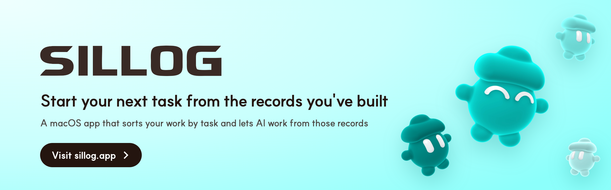</a>

[](#requirements)
[](LICENSE)
[](https://github.com/sillog-admin/SILLOG/actions/workflows/ci.yml)

**[Download for macOS](https://github.com/sillog-admin/sillog/releases/latest/download/SILLOG.dmg)** · [sillog.app](https://sillog.app) · [한국어](README.md)

<sub>macOS 14 or later, Apple silicon Mac</sub>

    

</div>

SILLOG records what you do on your Mac: the apps and windows you use, the pages you visit, the text on screen, your files, your prompts to AI coding tools, and voice recordings. An LLM groups that activity into tasks and draws them as a graph. In chat, you can then ask for a report, a piece of research, or a plan built from those records, and every answer links back to the records it used.

It's an early prototype. The download isn't notarized by Apple yet, so the first launch takes one extra step (see [Install](#install)). It also collects a lot about your work, so please read [Privacy and data](#privacy-and-data) before you turn it on.

## Tasks and sources, connected in a graph

Tasks, sessions, sources, and topics are stored with their links. You can switch between a 2D network, a 3D network, a sunburst chart, and a Sankey diagram.

| 2D network | 3D network |
| :---: | :---: |
| 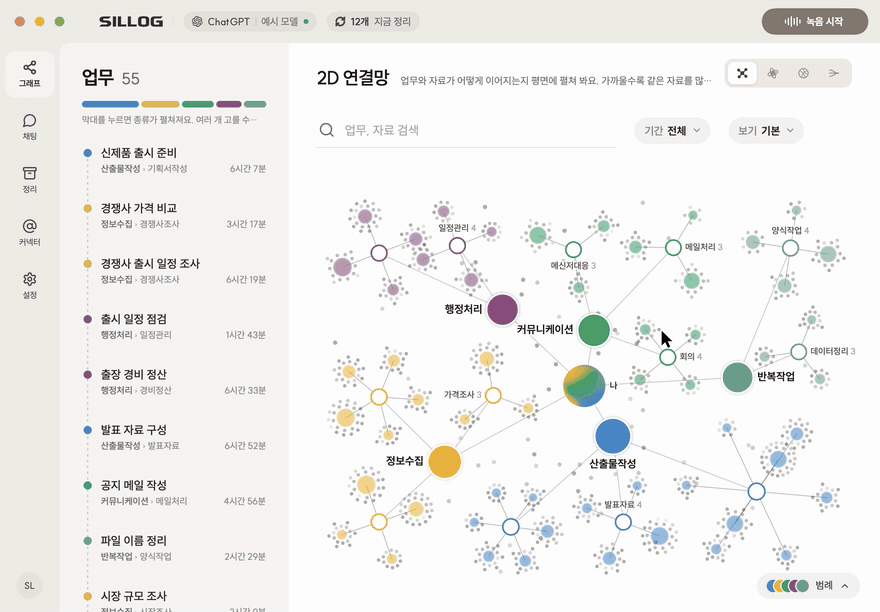 | 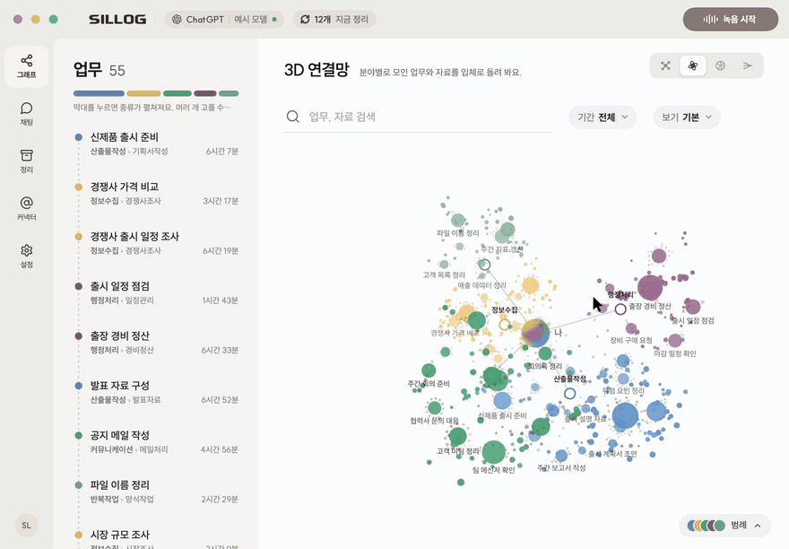 |
| **Sunburst chart** | **Sankey diagram** |
| 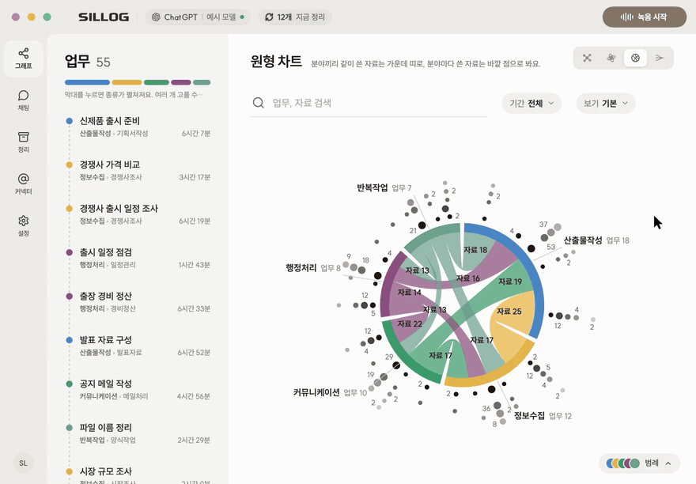 | 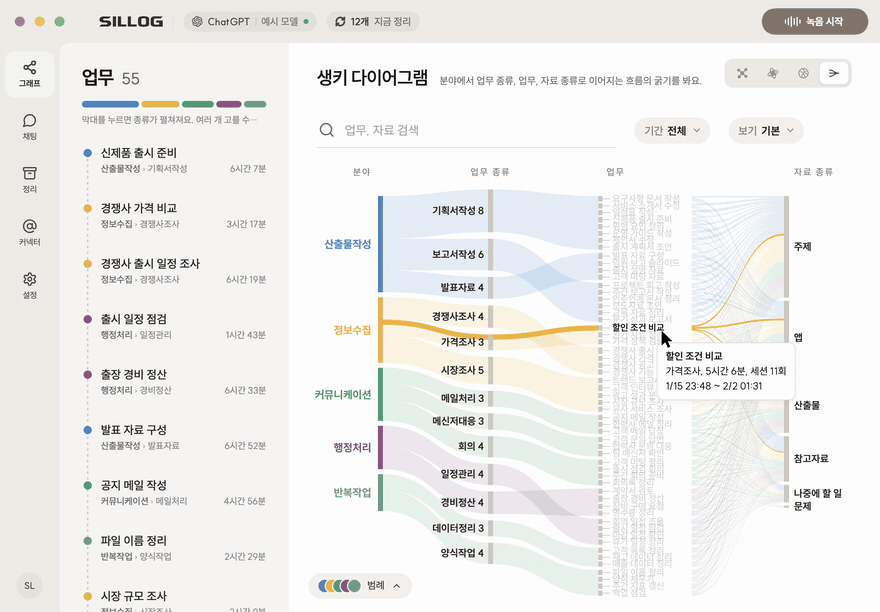 |

## Just ask

Pick a skill and ask the way you normally would. SILLOG finds what it needs in your records.

> Write this week's work report · Write a portfolio entry for this project · Put what I was reading yesterday into a comparison table · Prioritize what's left · Explain the concepts in what I read recently
>
> Draft a slide deck · Make the weekly report every week · Sort out entries for my career history · Find more on this topic and cite sources · Make next week's plan
>
> Make review notes · Draft a post from this work · Write the quarterly report · Show me what I found last week · Every morning, sum up what I did yesterday

## Sorted by task, no typing needed

Once you grant permissions the first time, SILLOG records on its own. Scattered records like a market research PDF, a web page, Word, meeting notes, Keynote, and Excel come together into tasks like these.

| Task | Area |
| --- | --- |
| Prepare a product launch | Deliverables › Planning doc |
| Compare competitor pricing | Research › Competitor research |
| Check the launch schedule | Admin › Scheduling |
| Write an announcement email | Communication › Email |
| Build the presentation | Deliverables › Slides |

## A quick tour

Your organized records are ready to use in chat. Write a report from them, save what you make, and reopen what you were working with.

The app is in Korean for now.

| | |
| :---: | :---: |
| 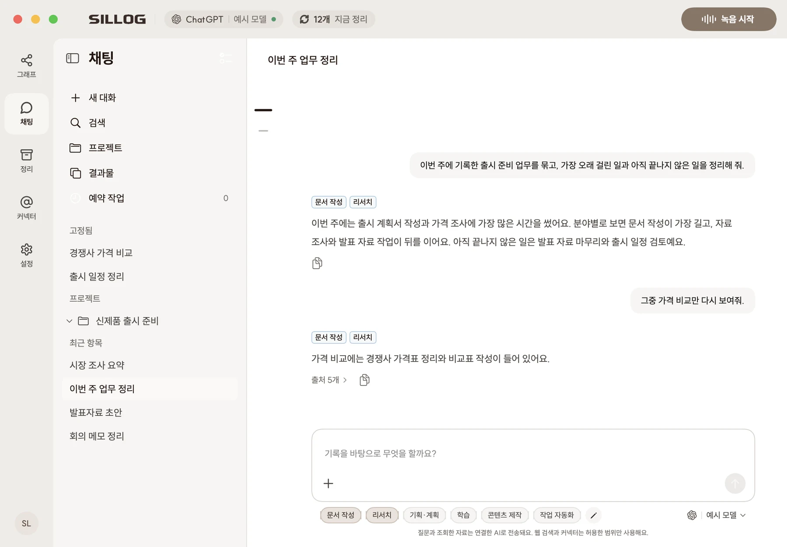<br>**Write a report**<br>Pick the writing skill and ask, and SILLOG reads your task records to write the report. | 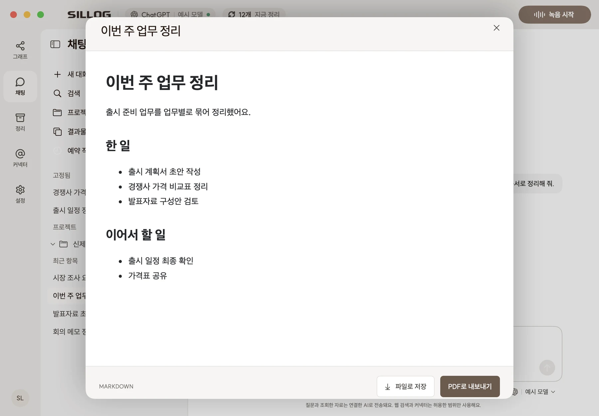<br>**Save results**<br>Save what you make as a file or export it to PDF. |
| 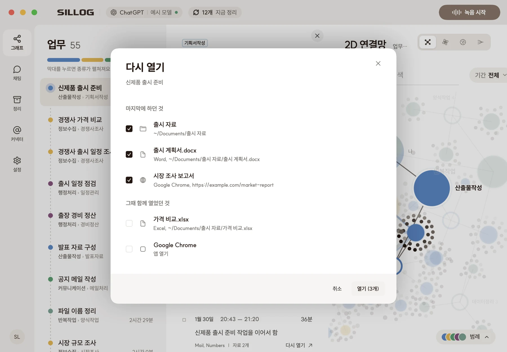<br>**Reopen**<br>Pick a session to reopen the files, pages, and apps you were using. | 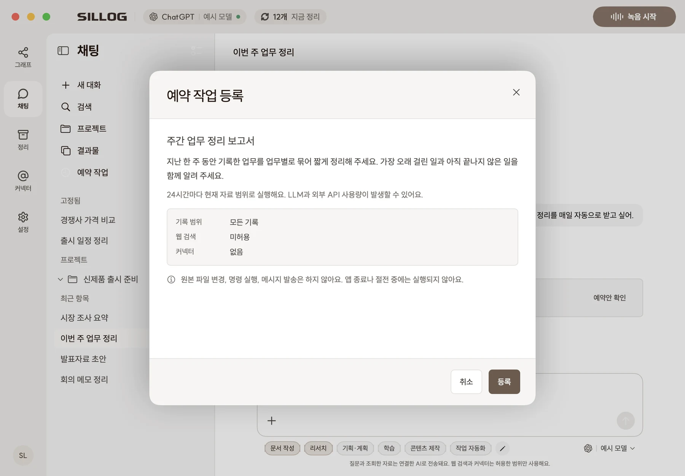<br>**Scheduled tasks**<br>For recurring work, SILLOG shows a draft schedule first and adds it once you approve. |
| 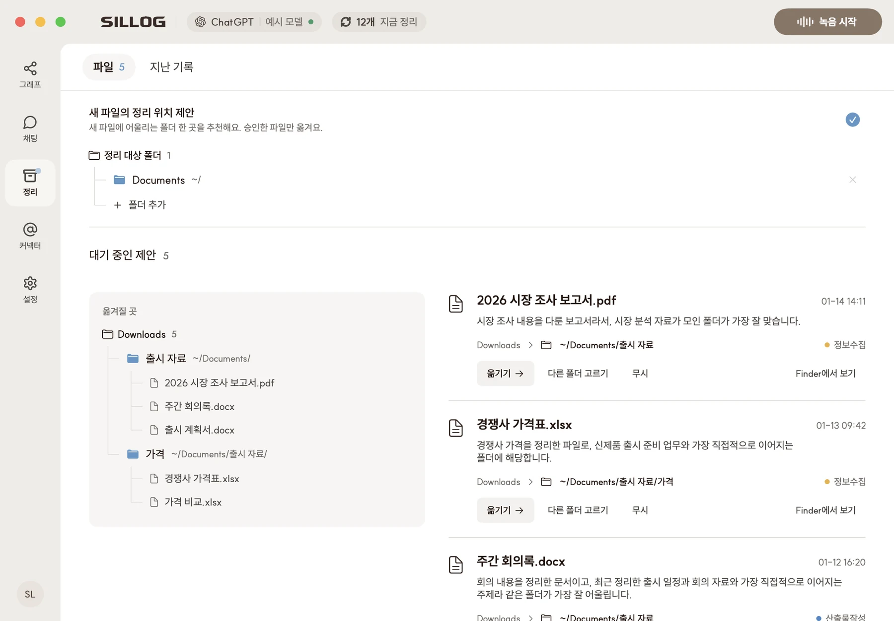<br>**Folder suggestions**<br>Suggests a folder for new downloads and moves them once you approve. | 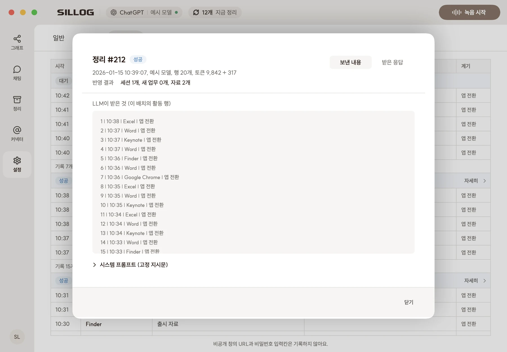<br>**See what was sent**<br>Check what went to your AI account, and what came back, in the activity log. |

## Your raw records stay on your Mac, and you can check what's sent

SILLOG has no server of its own. Organizing and chat go through the AI account you connect.

<table align="center">
  <tr>
    <td align="center"><br><b>Store</b><br>Records stay on your Mac</td>
    <td align="center">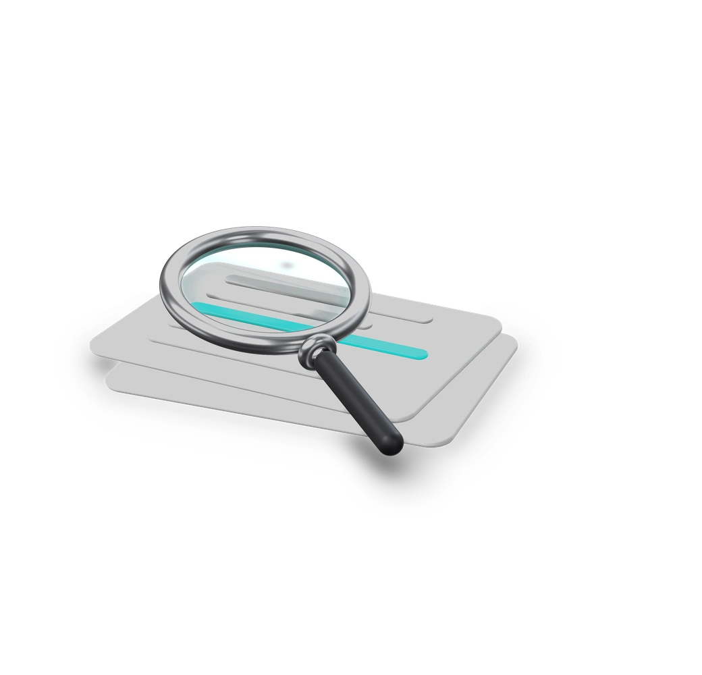<br><b>Check</b><br>See what was sent and what came back in the activity log</td>
    <td align="center">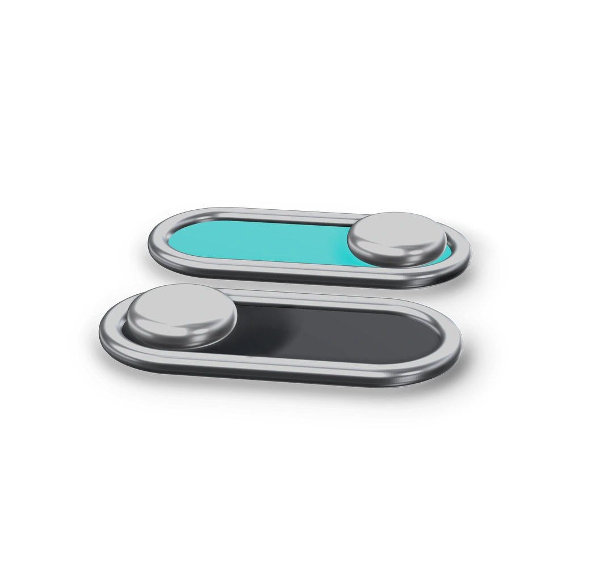<br><b>Control</b><br>Turn off sending for each feature</td>
  </tr>
</table>

Password fields are never recorded. For apps like password managers and Keychain, only the app name and time are kept. Details are in [Privacy and data](#privacy-and-data).

## What it does

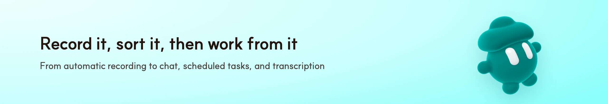

- Records the active app, window title, URL, on-screen text, screenshots, downloaded files, and what you ask Claude Code and Codex. For apps you exclude, it keeps only the name and time.
- Every five minutes, sorts new activity into tasks, sessions, resources, problems, and topics, and shows them as a graph. You can reopen the files and pages behind a task, or delete a node along with its raw records.
- Answers questions like "what did I do on the payment bug last week?" or "write my weekly report" from your records. You can limit a conversation to certain tasks or areas.
- Comes with skills for writing, research, planning, learning, content, and automation. You can edit them or add your own.
- Saves results as Markdown, HTML (including slide decks), CSV, JSON, or TXT, and exports them to PDF. Everything you make goes into the library.
- Runs recurring research or reports as scheduled tasks, but only after you approve them.
- Records lectures and meetings from the menu bar, transcribes them on your Mac with Whisper, and adds a title and summary.
- Once a day, suggests merging duplicate tasks and closing finished to-dos, and suggests folders for new downloads. Nothing changes until you approve.
- Deletes old raw records after a period you set and keeps weekly and monthly digests in their place.

## How it works

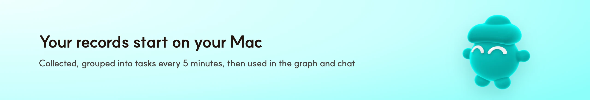

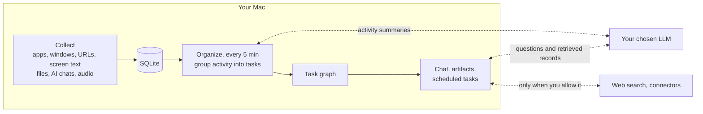

All records are stored in SQLite on your Mac. The only things that leave it are what's sent to the model you configure for organizing and chat, plus web searches and connector requests you allow.

## Install

<a href="https://github.com/sillog-admin/sillog/releases/latest/download/SILLOG.dmg">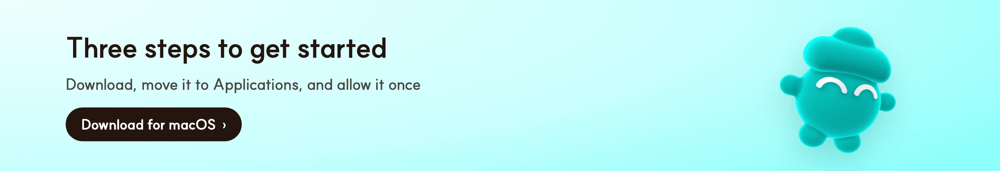</a>

### Requirements

- macOS 14 Sonoma or later
- A ChatGPT account. You sign in with ChatGPT on first launch, and nothing is recorded before that.
- To chat through your ChatGPT subscription, the [Codex app or Codex CLI](https://developers.openai.com/codex) must be installed. You can use any OpenAI-compatible API server instead.

### Download

1. On [sillog.app](https://sillog.app), click **Download for macOS**. This downloads `SILLOG.dmg` from the [latest GitHub release](https://github.com/sillog-admin/SILLOG/releases/latest).
2. Open the dmg and drag SILLOG to Applications.
3. The first time you open SILLOG, macOS says *"SILLOG" Not Opened*, because the app isn't notarized. Click **Done**, go to System Settings → Privacy & Security, click **Open Anyway** near the bottom, and then click **Open**. Since macOS 15, Control-click → Open no longer works for this.

Releases are signed with the same certificate every time, so updates keep your keychain access and permissions. If you installed a build from before that change, the first update asks once more: allow keychain access, then grant Accessibility and Screen Recording again.

### First launch

1. Sign in to ChatGPT with the device code shown in your browser.
2. Allow Accessibility and Screen Recording. Screen Recording takes effect after you restart SILLOG. Microphone, Speech Recognition, and Calendars are requested the first time you use those features.
3. In Settings, choose what to record: screen text, screenshots, AI coding tool chats, and apps to exclude.
4. In Settings → AI, pick the models for organizing and for chat.

You can pause recording or run organizing right away from the menu bar.

## AI connections

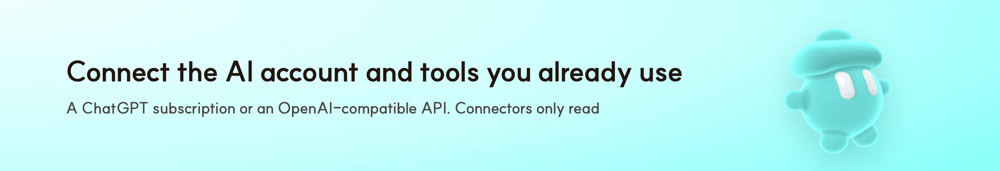

| Connection | Used for | Notes |
| --- | --- | --- |
| ChatGPT subscription | Organizing, chat, judging | Uses an app-only ChatGPT sign-in to reach the Codex backend. It counts against your plan's usage, with no separate bill. It isn't a public API, so it may change. Chat runs through a local `codex app-server` with shell and file writes turned off. |
| API server | Organizing, chat, judging | Any OpenAI-compatible `/chat/completions` server: a cloud service like OpenAI, or a local model through Ollama or LM Studio. You pay the provider. Web search works only with the official OpenAI API. |
| OpenAI Decisions, Jev | Judging | Models that only pick which task each activity row belongs to. |

## Connectors

Connectors only read. SILLOG never sends mail, edits files, or changes repositories through them. Connection details are kept in the macOS Keychain.

| Connector | How you connect | Status today |
| --- | --- | --- |
| Notion, Lovable, Higgsfield, Canva | Sign in and approve in the browser | Works without creating any keys |
| Slack | Sign in and approve in the browser | Your workspace may need an admin to approve the app |
| Gmail, Google Drive | Sign in with Google and approve | The Google app is still in testing, so only invited accounts can use it and you have to reconnect every 7 days |
| GitHub | Enter a device code | Not available in release builds yet |
| Figma, Discord | Paste a token you created | The connect window walks you through making one |

If you build SILLOG yourself, connector setup is in [docs/connectors.md](docs/connectors.md).

## Privacy and data

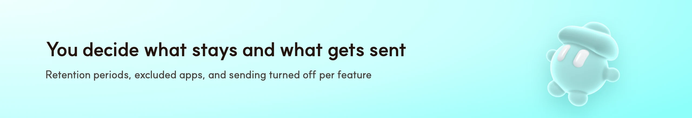

Your records are stored on your Mac, but whatever is used for organizing and chat is sent to the model you pick. With a cloud model, that text leaves your Mac.

- What's recorded: app names, window titles, URLs, on-screen text, screenshots if you turn them on, new files in Downloads, your prompts to Claude Code and Codex, and recordings you start. Excluded apps and SILLOG itself keep only the app name and time.
- What chat can read: records within the conversation's scope, files and folders you attach, library items, and connectors you turn on for that conversation. A file path showing up in your records doesn't mean chat will read that file.
- What chat won't do: run commands, edit or move files, send messages, or write to connectors.
- Secrets: API keys and connector tokens go in the Keychain. The ChatGPT sign-in is kept in a file with `600` permissions that's excluded from backups. ID numbers such as national ID numbers are masked in tool results before they reach the model.
- Default retention: screen text 30 days, screenshots 7 days, activity 90 days, screen cards 180 days, AI tool and file records 365 days. You can change these in Settings → General, and SILLOG asks once before it deletes anything for the first time.
- Deleting: right-click a task, area, or graph node to delete it together with its raw records.

```text
~/Library/Application Support/Sillog/
├── sillog.sqlite   # activity, graph, chats, artifacts, schedules
├── captures/       # screenshots
├── library/        # uploaded files, artifacts, saved answers
├── codex-auth.json # app-only ChatGPT sign-in
└── app.log         # run log
```

## FAQ

<details>
<summary><b>What does SILLOG record?</b></summary>

Apps, window titles, URLs, file paths, on-screen text, screenshots, downloaded files, and the messages you type into AI coding tools (Claude Code, Codex CLI). If there's no input for more than two minutes, it records you as away. It records audio only when you start a recording, and transcribes it on your Mac.
</details>

<details>
<summary><b>Where are my records stored?</b></summary>

On your Mac. SILLOG has no server of its own.
</details>

<details>
<summary><b>What leaves my Mac?</b></summary>

To organize tasks and answer in chat, SILLOG sends record contents to the AI account you connect, along with screenshots of key screens. Sources looked up in chat, web searches you allow, and connector requests also leave your Mac. You can check what was sent in the activity log and turn off sending for each feature.
</details>

<details>
<summary><b>Which AI account do I need?</b></summary>

Connect either a ChatGPT subscription or an OpenAI-compatible API. To chat through ChatGPT, the Codex CLI or Codex app must be installed. With an API, you pay per call.
</details>

<details>
<summary><b>There are apps I don't want recorded.</b></summary>

Add them to the excluded apps, and only their name and time are kept. Password managers and Keychain are excluded from the start, and password fields are never recorded.
</details>

<details>
<summary><b>How long are screenshots kept?</b></summary>

Seven days by default. You can set anywhere from 1 to 90 days.
</details>

<details>
<summary><b>Which computers does it run on?</b></summary>

For now, Apple silicon Macs on macOS 14 or later. Windows and mobile aren't ready yet.
</details>

## Known limitations

- It runs only on macOS, and the download isn't notarized yet.
- Artifacts are text formats plus PDF export. SILLOG can read DOCX, PPTX, and XLSX but can't create them.
- Scheduled tasks repeat every few hours and only run while SILLOG is open. You can't pick a weekday or time of day.
- Scanned PDFs aren't OCR'd, and images are read only for the text in them.
- Gmail and Drive are limited to test accounts until Google finishes its review.

## Build from source

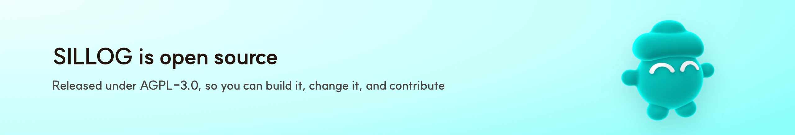

You need Xcode 26 (Swift 6.2). Command Line Tools can build the app but can't run the tests. An app you build yourself wasn't downloaded from the internet, so you won't see the "Not Opened" dialog.

```bash
git clone https://github.com/sillog-admin/SILLOG.git
cd SILLOG
./scripts/make-app.sh
open build/SILLOG.app
```

`make-app.sh` makes a release build, signs it, and installs it to `~/Applications`. For development:

```bash
swift build
swift test
swift run sillogctl --help
```

`sillogctl` opens your real record database by default, so pass `--db` with a scratch file when you experiment. More details:

- [docs/development.md](docs/development.md): keeping permissions across rebuilds, environment variables, and running the pipeline without a model
- [docs/connectors.md](docs/connectors.md): OAuth setup for each connector
- [CLAUDE.md](CLAUDE.md): code structure and conventions
- The [chat system prompt](Sources/SillogCore/Chat/Prompts/chat-system-prompt.md) and [skills](Sources/SillogCore/Chat/Skills)

## Contributing

Issues and pull requests are welcome. Please run `swift build` and `swift test` locally before you open a PR, since CI skips a few OCR-based UI tests. Commit messages are one line in the form `type: summary`, like `fix: handle expired token`. Don't commit `.env`, API keys, or dumps of your own records. Contributions are distributed under AGPL-3.0.

Please report security issues through [private vulnerability reporting](https://github.com/sillog-admin/SILLOG/security/advisories/new) rather than a public issue.

## License

SILLOG is released under the [GNU Affero General Public License v3.0](LICENSE). Anyone can use, modify, and redistribute it. If you distribute a modified version, or offer it to others over a network like a web service, you have to publish that version's full source code under the same license.

Bundled libraries keep their own licenses. [GRDB.swift](https://github.com/groue/GRDB.swift), [WhisperKit](https://github.com/argmaxinc/WhisperKit), [SwiftMath](https://github.com/mgriebling/SwiftMath), [LangGraph-Swift](https://github.com/bsorrentino/LangGraph-Swift), [force-graph](https://github.com/vasturiano/force-graph), [FullCalendar](https://github.com/fullcalendar/fullcalendar), and [Mermaid](https://github.com/mermaid-js/mermaid) are MIT, and the SUIT and Jost fonts are [SIL OFL 1.1](Sources/SillogApp/Resources/Brand/Fonts). Other notices are in [THIRD_PARTY_NOTICES.md](THIRD_PARTY_NOTICES.md).

---

<div align="center">

    

### Meet SILLOG

**[Download for macOS](https://github.com/sillog-admin/sillog/releases/latest/download/SILLOG.dmg)** · [sillog.app](https://sillog.app)

</div>
