<div align="center">

<a href="https://sillog.app">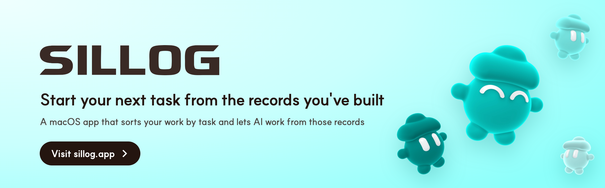</a>

[](#requirements)
[](LICENSE)
[](https://github.com/sillog-admin/SILLOG/actions/workflows/ci.yml)

<a href="https://github.com/sillog-admin/sillog/releases/latest/download/SILLOG.dmg"></a>&nbsp;
<a href="https://sillog.app"></a>&nbsp;
<a href="README.md"></a>

<sub>macOS 14 or later, Apple silicon Mac</sub>

    

</div>

SILLOG records what you do on your Mac: the apps and windows you use, the pages you visit, the text on screen, your files, your prompts to AI coding tools, and voice recordings. An LLM groups that activity into tasks and draws them as a graph. In chat, you can then ask for a report, a piece of research, or a plan built from those records, and every answer links back to the records it used.

It's an early prototype. It collects a lot about your work, so please read [Privacy and data](#privacy-and-data) before you turn it on.

## Tasks and sources, connected in a graph

Tasks, sessions, sources, and topics are stored with their links. You can switch between a 2D network, a 3D network, a sunburst chart, and a Sankey diagram.

| 2D network | 3D network |
| :---: | :---: |
| 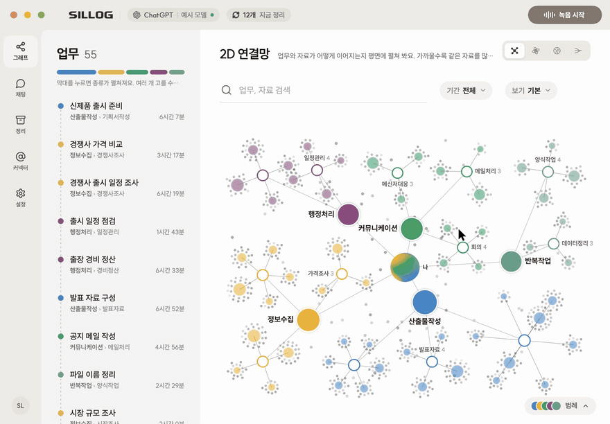 | 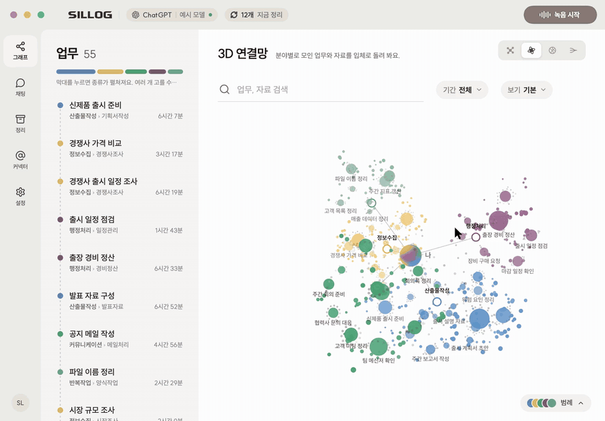 |
| **Sunburst chart** | **Sankey diagram** |
| 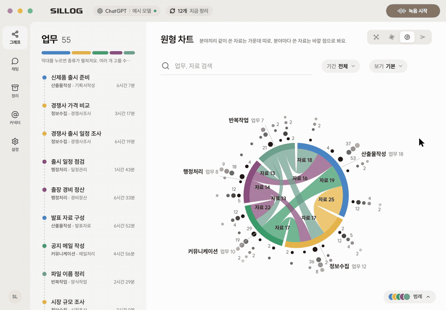 | 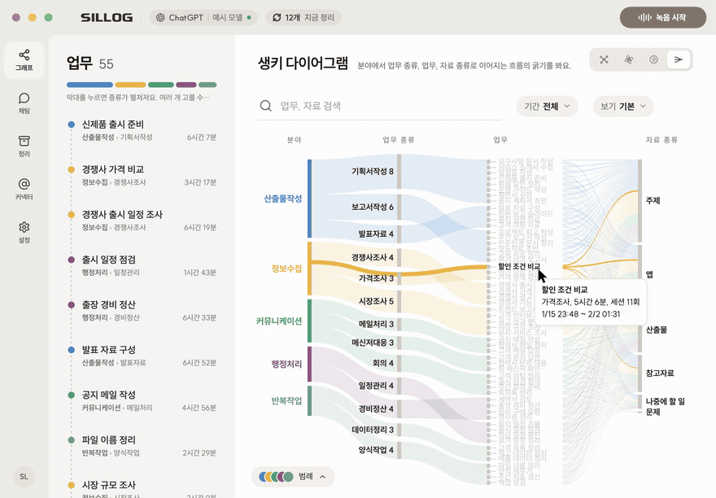 |

## Just ask

Pick a skill and ask the way you normally would. SILLOG finds what it needs in your records.

| Skill | Examples |
| --- | --- |
| Writing | Write this week's work report<br>Sort out entries for my career history |
| Research | Put what I was reading yesterday into a comparison table<br>Find more on this topic and cite sources |
| Planning | Prioritize what's left<br>Make next week's plan |
| Learning | Explain the concepts in what I read recently<br>Make review notes |
| Content | Draft a slide deck<br>Draft a post from this work |
| Automation | Make the weekly report every week<br>Every morning, sum up what I did yesterday |

## Sorted by task, no typing needed

Once you grant permissions the first time, SILLOG records on its own. Scattered records come together into tasks like these.

| Task | Area |
| --- | --- |
| Prepare a product launch | Deliverables › Planning doc |
| Compare competitor pricing | Research › Competitor research |
| Check the launch schedule | Admin › Scheduling |
| Write an announcement email | Communication › Email |
| Build the presentation | Deliverables › Slides |

## A quick tour

Your organized records are ready to use in chat. Write a report from them, save what you make, and reopen what you were working with.

The app is in Korean for now.

| | |
| :---: | :---: |
| 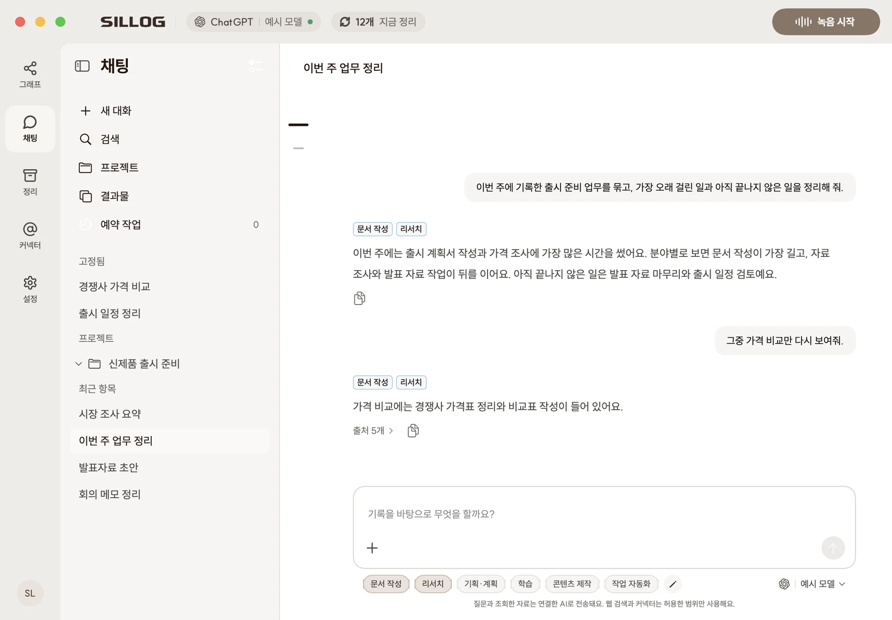<br>**Write a report**<br>Pick the writing skill and ask, and SILLOG reads your task records to write the report. | 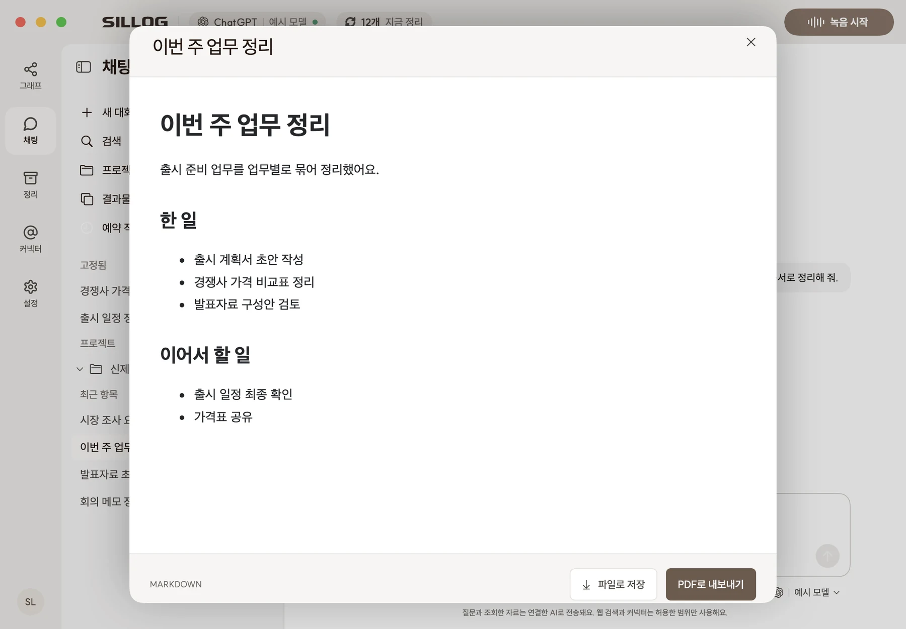<br>**Save results**<br>Save what you make as a file or export it to PDF. |
| 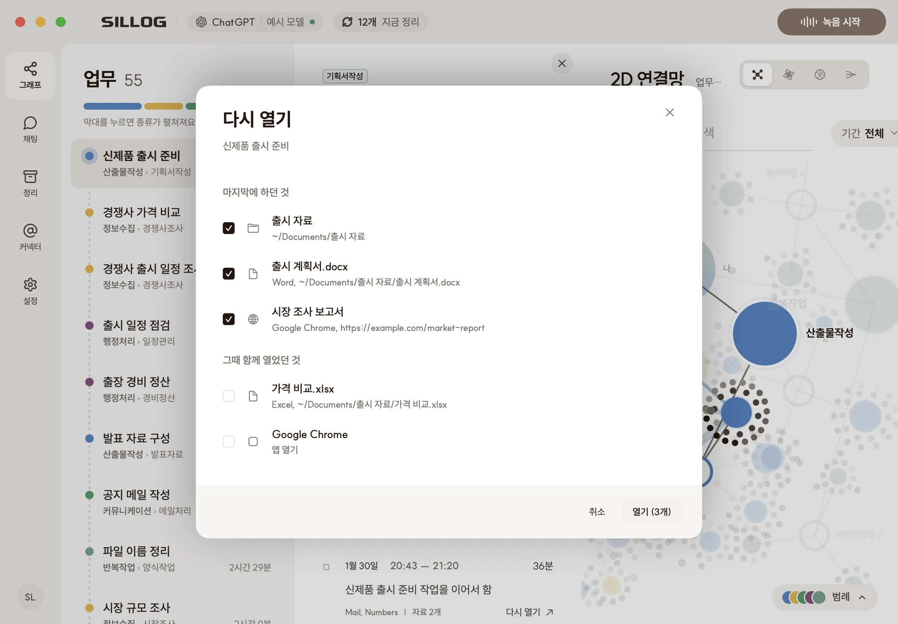<br>**Reopen**<br>Pick a session to reopen the files, pages, and apps you were using. | 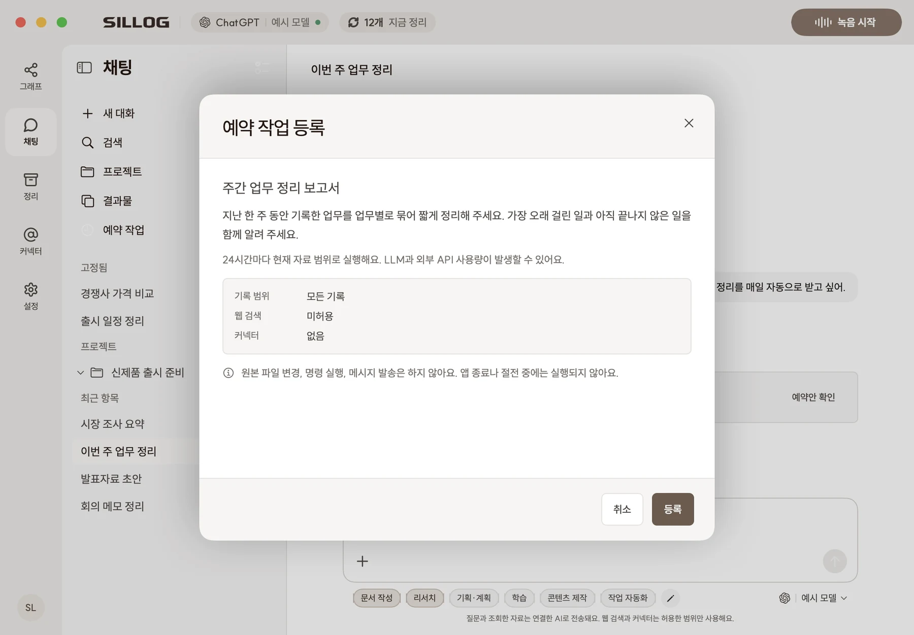<br>**Scheduled tasks**<br>For recurring work, SILLOG shows a draft schedule first and adds it once you approve. |
| 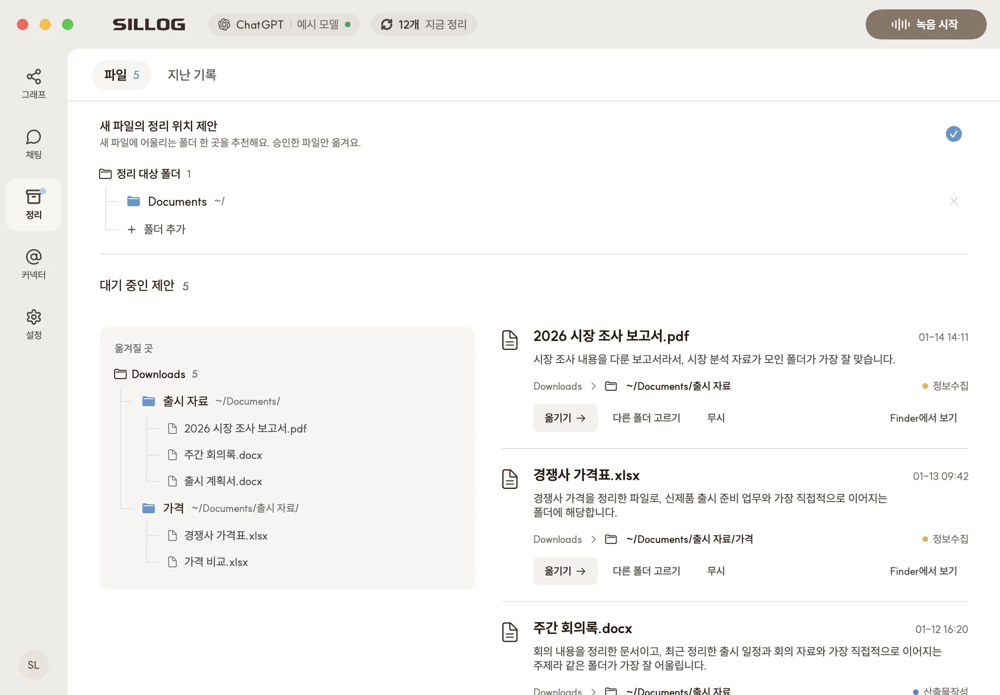<br>**Folder suggestions**<br>Suggests a folder for new downloads and moves them once you approve. | 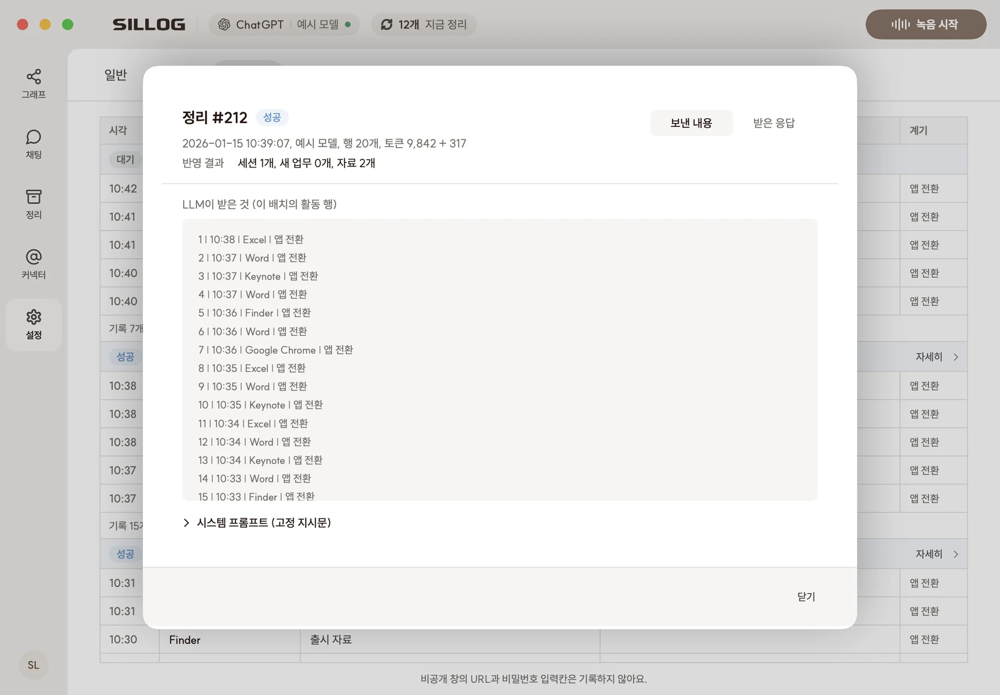<br>**See what was sent**<br>Check what went to your AI account, and what came back, in the activity log. |

## Your raw records stay on your Mac, and you can check what's sent

SILLOG has no server of its own. Organizing and chat go through the AI account you connect.

<a href="https://sillog.app">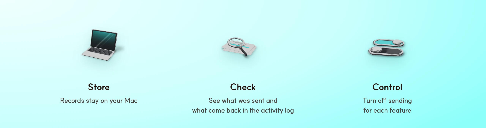</a>

Password fields are never recorded. For apps like password managers and Keychain, only the app name and time are kept. Details are in [Privacy and data](#privacy-and-data).

## What it does

<a href="https://sillog.app">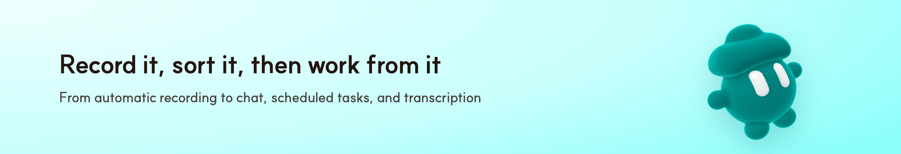</a>

- **Recording**: automatically saves the apps and windows you use, web pages, on-screen text, and files.
- **Organizing**: every five minutes, groups new activity into tasks and links them in the graph.
- **Reopening**: brings back the files and pages behind a task.
- **Chat**: answers questions and writes reports from your records.
- **Other AI apps**: lets the ChatGPT and Claude desktop apps answer from your SILLOG records.
- **Skills**: lets you edit the built-in skills or add your own.
- **Artifacts**: saves results as documents, slides, and tables and keeps them in the library.
- **Scheduled tasks**: runs recurring research or reports on the interval you set.
- **Voice recording**: transcribes and summarizes lectures and meetings on your Mac.
- **Suggestions**: suggests merging duplicate tasks and moving new files into folders. Nothing changes until you approve.
- **Retention**: deletes old raw records and keeps digests.

## How it works

<a href="https://sillog.app">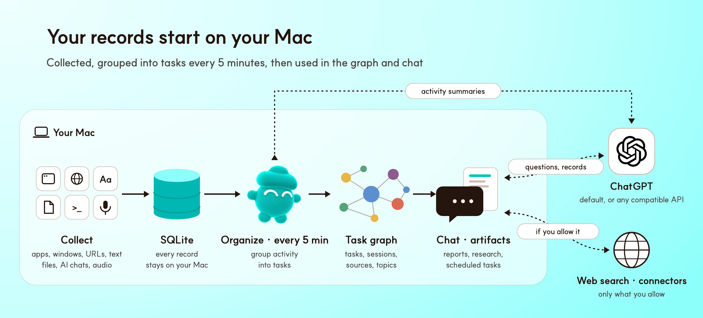</a>

All records are stored in SQLite on your Mac. The only things that leave it are what's sent to the model you configure for organizing and chat, plus web searches and connector requests you allow.

## Install

<a href="https://sillog.app">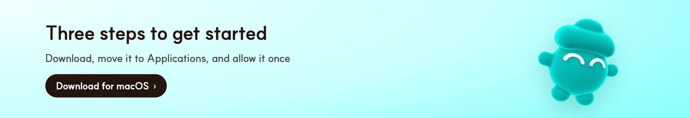</a>

### Requirements

- macOS 14 Sonoma or later on an Apple silicon Mac
- A ChatGPT subscription or an OpenAI-compatible API key. Nothing is recorded until you connect an AI.
- To chat through your ChatGPT subscription, the [Codex app or Codex CLI](https://developers.openai.com/codex) must be installed.

### Download

1. Download `SILLOG.dmg` from [sillog.app](https://sillog.app) or the [latest release](https://github.com/sillog-admin/SILLOG/releases/latest).
2. Open the dmg and drag SILLOG to Applications.
3. Open SILLOG. macOS asks once whether to open it. Click **Open**.

Releases are signed with Developer ID and notarized by Apple.

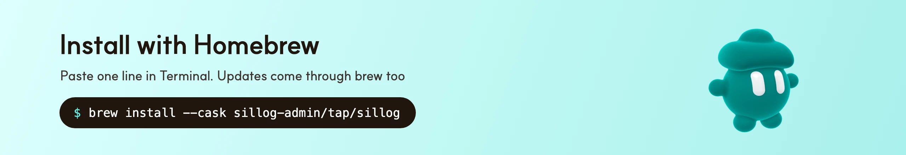

```bash
brew install --cask sillog-admin/tap/sillog
```

- Update: `brew upgrade --cask sillog`
- Uninstall: `brew uninstall --cask sillog`
- Uninstall with your records: `brew uninstall --zap --cask sillog`

If SILLOG is already installed from the dmg, add `--force` to the install command. `--zap` moves your records and settings to the Trash and leaves keys and tokens in the keychain.

### First launch

1. Connect an AI with your ChatGPT account or an API key.
2. Allow Accessibility and Screen Recording. Screen Recording takes effect after you restart SILLOG.
3. In Settings, choose what to record and which models to use.

You can pause recording or run organizing right away from the menu bar.

## AI connections

<a href="https://sillog.app"></a>

| Connection | Used for | Notes |
| --- | --- | --- |
| ChatGPT subscription | Organizing, chat, judging | Counts against your plan's usage |
| API server | Organizing, chat, judging | An OpenAI-compatible server or a local model |
| OpenAI Decisions, Jev | Judging | Only picks which task a record belongs to |

The ChatGPT subscription connection isn't a public API, so it may change.

## Connectors

Connect services like Notion, Slack, Google Drive, and GitHub, and chat can look things up there too. Connectors only read, and connection details are kept in the macOS Keychain.

If you build SILLOG yourself, connector setup is in [docs/connectors.md](docs/connectors.md).

## Other AI apps

In Settings → AI connection, use "Connect other AI apps with MCP" to register SILLOG with the ChatGPT or Claude desktop app, and that app can look up and read your SILLOG records to answer. ChatGPT works in the desktop app's Work and Codex, and Claude in its desktop app. For other MCP apps such as Cursor, copy the config and paste it into that app.

The tools SILLOG offers only read, and records from projects set to "Project memory" aren't sent. If you build SILLOG yourself, `sillogctl mcp` runs the same server; details are in [docs/development.md](docs/development.md).

## Privacy and data

<a href="https://sillog.app">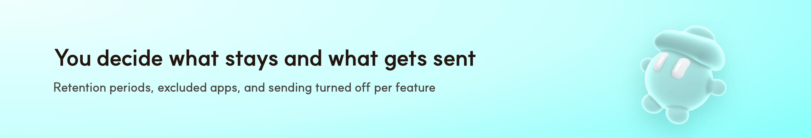</a>

Your records are stored on your Mac, but whatever is used for organizing and chat is sent to the model you pick. With a cloud model, that text leaves your Mac. The [Privacy Policy](https://sillog.app/privacy) covers what the app handles, what leaves your Mac, retention and deletion, and how to contact us.

- **What's recorded**: app names, window titles, URLs, on-screen text, screenshots, downloaded files, your prompts to AI coding tools, and recordings you start.
- **Name and time only**: excluded apps, password managers, and SILLOG itself.
- **What chat can read**: records within the conversation's scope, files you attach, library items, and connectors you turn on.
- **What chat won't do**: run commands, edit files, send messages, or write to connectors.
- **What other AI apps read**: records and library items that an app connected through MCP looks up. That content goes to the AI that app uses.
- **Secrets**: API keys and tokens go in the Keychain. ID numbers such as national ID numbers are masked before they reach the model.
- **Deleting**: right-click a task or graph node to delete it together with its raw records.

Default retention is below. You can change it in Settings → General, and SILLOG asks once before it deletes anything for the first time.

| Screen text | Screenshots | Activity | Screen cards | AI tool and file records |
| :---: | :---: | :---: | :---: | :---: |
| 30 days | 7 days | 90 days | 180 days | 365 days |

```text
~/Library/Application Support/Sillog/
├── sillog.sqlite   # activity, graph, chats, artifacts, schedules
├── captures/       # screenshots
├── library/        # uploaded files, artifacts, saved answers
├── recordings/     # voice recordings
├── models/         # transcription model
├── codex-auth.json # app-only ChatGPT sign-in
└── app.log         # run log
```

## FAQ

<details>
<summary><b>What does SILLOG record?</b></summary>

Apps, window titles, URLs, file paths, on-screen text, screenshots, downloaded files, and the messages you type into AI coding tools (Claude Code, Codex CLI). If there's no input for more than two minutes, it records you as away. It records audio only when you start a recording, and transcribes it on your Mac.
</details>

<details>
<summary><b>Where are my records stored?</b></summary>

On your Mac. SILLOG has no server of its own.
</details>

<details>
<summary><b>What leaves my Mac?</b></summary>

To organize tasks and answer in chat, SILLOG sends record contents to the AI account you connect, along with screenshots of key screens. Sources looked up in chat, web searches you allow, and connector requests also leave your Mac. You can check what was sent in the activity log and turn off sending for each feature. Records that a ChatGPT or Claude app connected through MCP looks up go to that app's AI.
</details>

<details>
<summary><b>Which AI account do I need?</b></summary>

Connect either a ChatGPT subscription or an OpenAI-compatible API. To chat through ChatGPT, the Codex CLI or Codex app must be installed. With an API, you pay per call.
</details>

<details>
<summary><b>There are apps I don't want recorded.</b></summary>

Add them to the excluded apps, and only their name and time are kept. Password managers and Keychain are excluded from the start, and password fields are never recorded.
</details>

<details>
<summary><b>How long are screenshots kept?</b></summary>

Seven days by default. You can set anywhere from 1 to 90 days.
</details>

<details>
<summary><b>Which computers does it run on?</b></summary>

For now, Apple silicon Macs on macOS 14 or later. Windows and mobile aren't ready yet.
</details>

## Known limitations

- It runs only on macOS.
- Word, PowerPoint, and Excel artifacts use basic formatting with text and tables only.
- Scheduled tasks repeat every few hours and only run while SILLOG is open. You can't pick a weekday or time of day.
- Scanned PDFs aren't OCR'd, and images are read only for the text in them.
- With an API server, web search works only with the official OpenAI API.
- There is no Gmail connector.
- MCP works only in desktop apps. In ChatGPT it works in Work and Codex, not regular chat, and not on the web or mobile.

## Build from source

You need Xcode 26 (Swift 6.2). Command Line Tools can build the app but can't run the tests.

Estimated time: about 2 minutes

```bash
git clone https://github.com/sillog-admin/SILLOG.git
cd SILLOG
./scripts/make-app.sh
open build/SILLOG.app
```

`make-app.sh` makes a release build, signs it, and installs it to `~/Applications`. For development:

```bash
swift build
swift test
swift run sillogctl --help
```

`sillogctl` opens your real record database by default, so pass `--db` with a scratch file when you experiment. More details:

- [docs/development.md](docs/development.md): keeping permissions across rebuilds, environment variables, and running the pipeline without a model
- [docs/connectors.md](docs/connectors.md): OAuth setup for each connector
- [CLAUDE.md](CLAUDE.md): code structure and conventions
- The [chat system prompt](Sources/SillogCore/Chat/Prompts/chat-system-prompt.md) and [skills](Sources/SillogCore/Chat/Skills)

## Contributing

Issues and pull requests are welcome. See [CONTRIBUTING.md](CONTRIBUTING.md) for what to check before you open one and how to write commits, and follow the [security policy](SECURITY.md) for security issues instead of opening a public issue.

## License

SILLOG is released under the [GNU Affero General Public License v3.0](LICENSE). Anyone can use, modify, and redistribute it. If you distribute a modified version, or offer it to others over a network like a web service, you have to publish that version's full source code under the same license.

Bundled libraries keep their own licenses. [GRDB.swift](https://github.com/groue/GRDB.swift), [WhisperKit](https://github.com/argmaxinc/WhisperKit), [SwiftMath](https://github.com/mgriebling/SwiftMath), [LangGraph-Swift](https://github.com/bsorrentino/LangGraph-Swift), [force-graph](https://github.com/vasturiano/force-graph), [FullCalendar](https://github.com/fullcalendar/fullcalendar), and [Mermaid](https://github.com/mermaid-js/mermaid) are MIT, and the SUIT and Jost fonts are [SIL OFL 1.1](Sources/SillogApp/Resources/Brand/Fonts). Other notices are in [THIRD_PARTY_NOTICES.md](THIRD_PARTY_NOTICES.md).

---

<div align="center">

    

### Meet SILLOG

<a href="https://github.com/sillog-admin/sillog/releases/latest/download/SILLOG.dmg"></a>&nbsp;
<a href="https://sillog.app"></a>

</div>
