<div align="center">

<a href="https://sillog.app">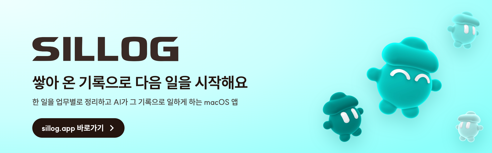</a>

[](#준비할-것)
[](LICENSE)
[](https://github.com/sillog-admin/SILLOG/actions/workflows/ci.yml)

<a href="https://github.com/sillog-admin/sillog/releases/latest/download/SILLOG.dmg"></a>&nbsp;
<a href="https://sillog.app"></a>&nbsp;
<a href="README.en.md"></a>

<sub>macOS 14 이상, Apple 실리콘 Mac</sub>

    

</div>

SILLOG(실록)은 Mac에서 쓰는 앱과 창, 웹페이지, 화면 글자, 파일, AI 코딩 도구에 보낸 요청, 녹음을 기록합니다. 기록은 LLM이 업무 단위로 묶어 그래프로 정리하고, 채팅에서는 이 기록을 근거로 보고서나 조사 결과, 계획을 만들어 줍니다. 답변마다 어떤 기록을 보고 썼는지 출처가 붙어 있어 바로 열어 볼 수 있습니다.

아직 초기 프로토타입입니다. 업무 기록을 꽤 많이 모으니 쓰기 전에 [개인정보와 데이터](#개인정보와-데이터)를 먼저 읽어 주세요.

## 업무와 자료가 그래프로 이어져요

업무, 세션, 자료, 주제를 서로 연결해 저장해요. 2D와 3D 연결망, 원형 차트, 생키 다이어그램으로 바꿔 볼 수 있어요.

| 2D 연결망 | 3D 연결망 |
| :---: | :---: |
| 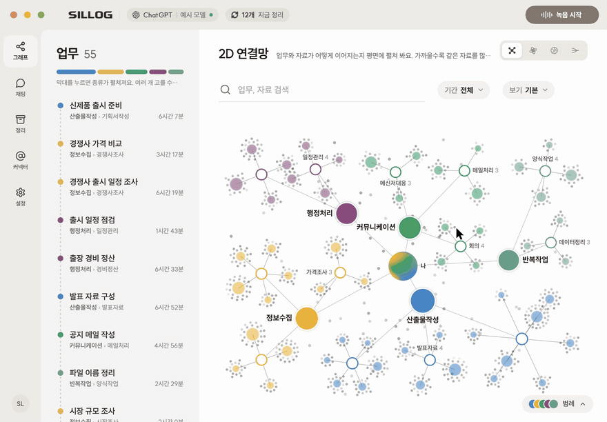 | 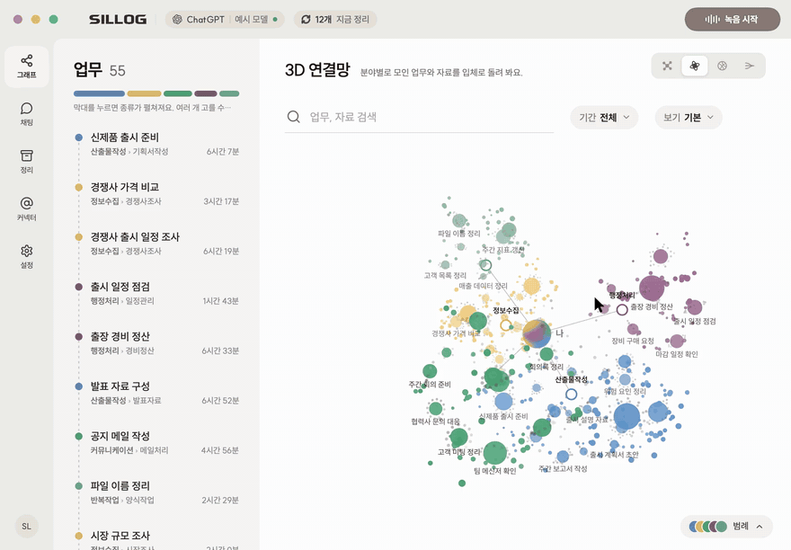 |
| **원형 차트** | **생키 다이어그램** |
| 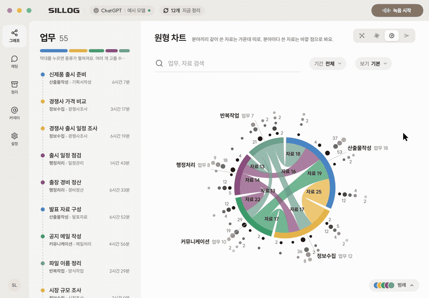 | 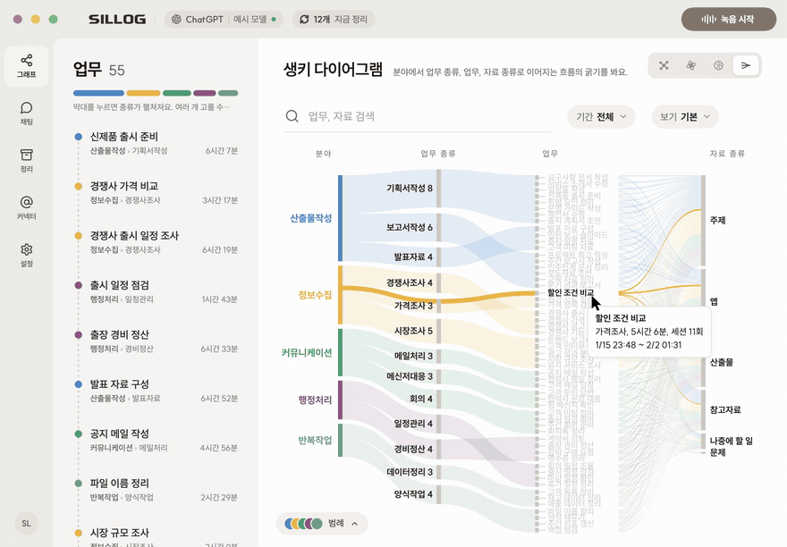 |

## 이렇게 부탁하면 돼요

스킬을 고르고 평소 말하듯 부탁하면, SILLOG이 기록에서 필요한 자료를 찾아요.

| 스킬 | 예시 |
| --- | --- |
| 문서 작성 | 이번 주 업무 보고서 써 줘<br>경력기술서 항목 정리해 줘 |
| 리서치 | 어제 보던 자료를 비교표로 정리해 줘<br>이 주제 자료 더 찾아서 출처 붙여 줘 |
| 기획·계획 | 남은 일 우선순위 정해 줘<br>다음 주 계획표 만들어 줘 |
| 학습 | 최근 읽은 자료 개념 설명해 줘<br>복습 자료 만들어 줘 |
| 콘텐츠 제작 | 발표자료 초안 만들어 줘<br>이번 작업으로 글 초안 써 줘 |
| 작업 자동화 | 주간 보고서를 매주 만들어 줘<br>매일 아침 어제 한 일 정리해 줘 |

## 입력하지 않아도 업무별로 정리돼요

처음 권한을 허용하면, 그 뒤로는 따로 입력하지 않아도 기록해요. 흩어진 기록이 이런 업무로 모여요.

| 업무 | 분야 |
| --- | --- |
| 신제품 출시 준비 | 산출물작성 › 기획서작성 |
| 경쟁사 가격 비교 | 정보수집 › 경쟁사조사 |
| 출시 일정 점검 | 행정처리 › 일정관리 |
| 공지 메일 작성 | 커뮤니케이션 › 메일처리 |
| 발표 자료 구성 | 산출물작성 › 발표자료 |

## 둘러보기

정리된 기록은 채팅에서 바로 써요. 기록을 근거로 보고서를 쓰고, 결과물을 저장하고, 그때 쓰던 자료를 다시 열 수 있어요.

| | |
| :---: | :---: |
| 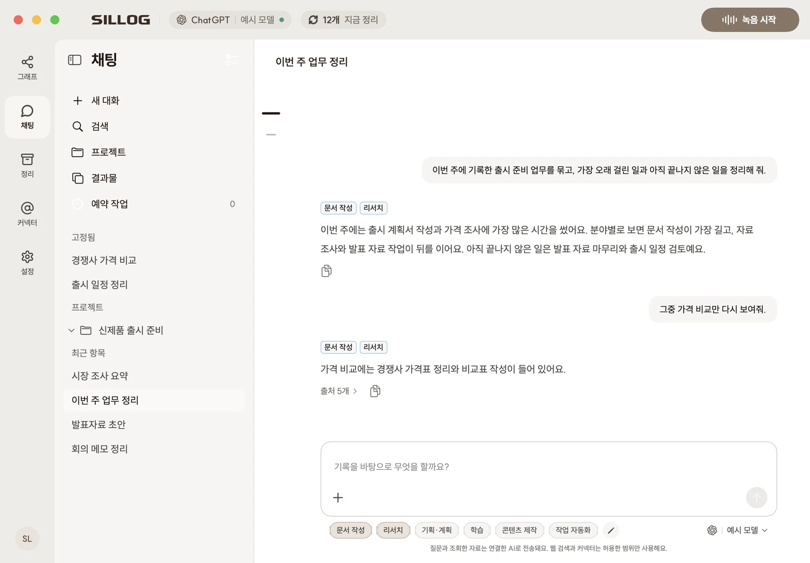<br>**보고서 작성**<br>문서 작성 스킬로 부탁하면 업무 기록을 읽어 보고서를 만들어요. | 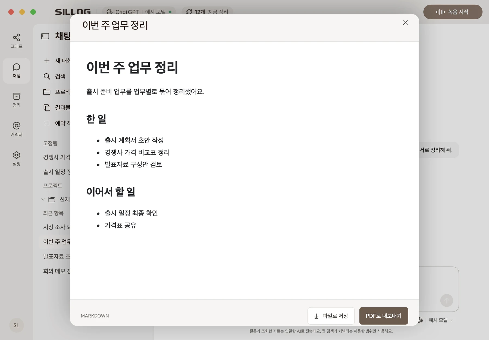<br>**결과물 저장**<br>만든 결과물은 파일로 저장하거나 PDF로 내보내요. |
| 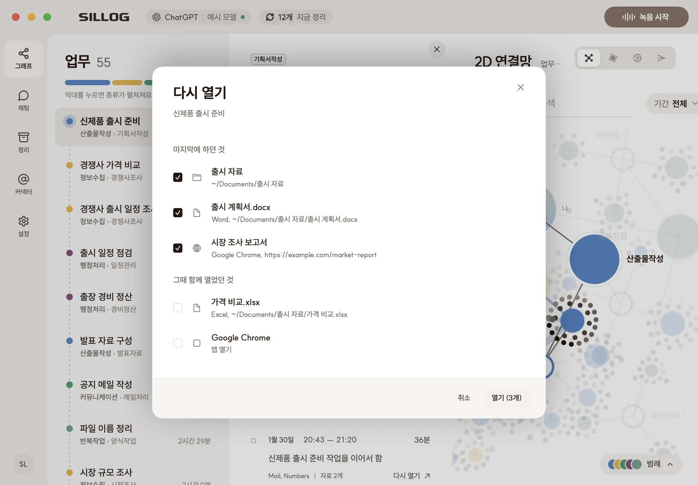<br>**다시 열기**<br>세션을 고르면 그때 쓰던 파일, 웹페이지, 앱을 다시 열어요. | 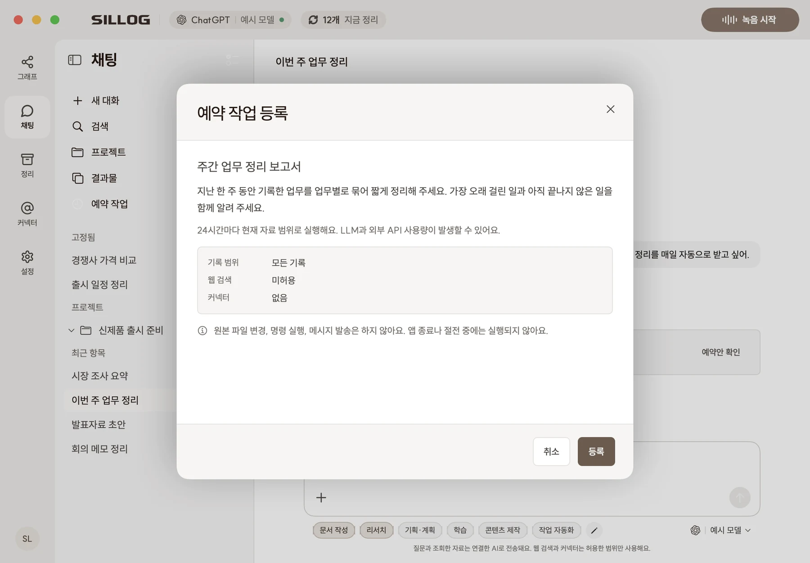<br>**예약 작업**<br>반복할 일은 예약안을 먼저 보여 주고 승인하면 등록해요. |
| 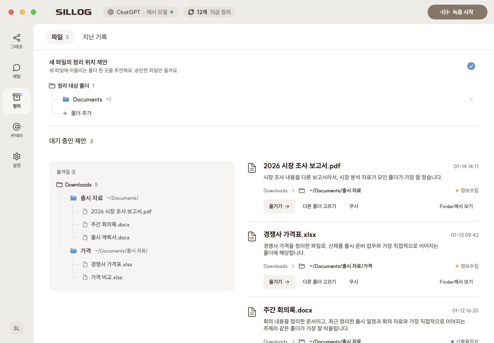<br>**파일 위치 추천**<br>새로 받은 파일을 옮길 폴더를 추천하고 승인하면 옮겨요. | 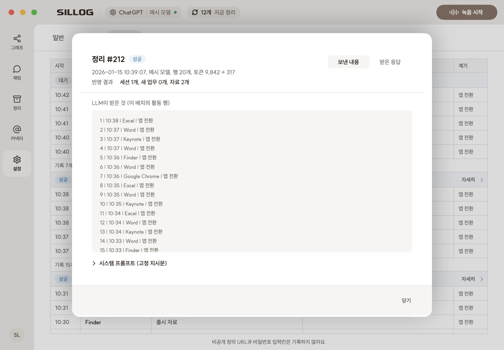<br>**보낸 내용 확인**<br>AI 계정으로 보낸 내용과 받은 결과를 활동 로그에서 확인해요. |

## 기록 원본은 내 Mac에 저장하고 보낸 내용은 직접 확인해요

SILLOG은 자체 서버를 두지 않아요. 업무 정리와 채팅은 내가 연결한 AI 계정으로 해요.

<a href="https://sillog.app">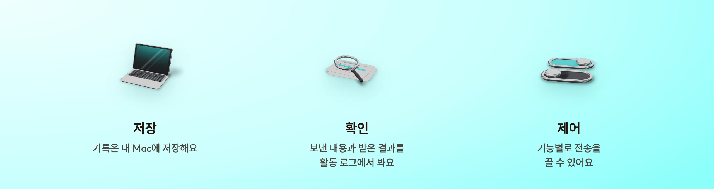</a>

비밀번호 입력칸은 기록하지 않아요. 비밀번호 관리자와 키체인 같은 앱은 이름과 시간만 남겨요. 자세한 내용은 [개인정보와 데이터](#개인정보와-데이터)에 있어요.

## 할 수 있는 일

<a href="https://sillog.app"></a>

- **기록**: 쓰는 앱과 창, 웹페이지, 화면 글자, 파일을 자동으로 남깁니다.
- **정리**: 5분마다 새 기록을 업무별로 묶어 그래프에 잇습니다.
- **다시 열기**: 업무마다 썼던 파일과 페이지를 다시 엽니다.
- **채팅**: 기록을 찾아 질문에 답하고 보고서를 씁니다.
- **스킬**: 기본 스킬을 고치거나 새로 만들 수 있습니다.
- **결과물**: 문서, 슬라이드, 표로 저장하고 보관함에 모읍니다.
- **예약 작업**: 반복할 조사나 보고를 정해 둔 간격으로 실행합니다.
- **녹음**: 강의나 회의를 Mac 안에서 받아쓰고 요약합니다.
- **제안**: 겹치는 업무를 합치거나 새 파일을 폴더로 옮기자고 제안하고, 승인한 것만 반영합니다.
- **보관**: 오래된 원본 기록은 지우고 요약을 남깁니다.

## 동작 방식

<a href="https://sillog.app">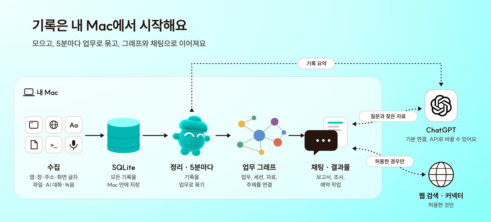</a>

기록은 모두 Mac 안의 SQLite에 저장합니다. 밖으로 나가는 것은 정리와 채팅에 쓰는 모델로 보내는 내용과, 허용한 웹 검색·커넥터 요청뿐입니다.

## 설치

<a href="https://sillog.app">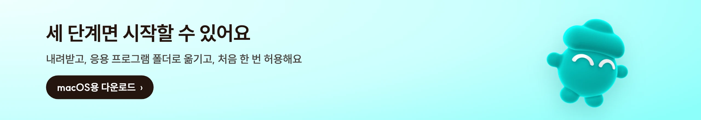</a>

### 준비할 것

- macOS 14 Sonoma 이상, Apple 실리콘 Mac
- ChatGPT 구독이나 OpenAI 호환 API 키. AI를 연결하기 전에는 아무것도 기록하지 않습니다.
- ChatGPT 구독으로 채팅하려면 [Codex 앱이나 Codex CLI](https://developers.openai.com/codex)가 설치되어 있어야 합니다.

### 다운로드

1. [sillog.app](https://sillog.app)이나 [최신 릴리스](https://github.com/sillog-admin/SILLOG/releases/latest)에서 `SILLOG.dmg`를 받습니다.
2. dmg를 열고 SILLOG을 응용 프로그램 폴더로 옮깁니다.
3. SILLOG을 엽니다. 처음 열 때 확인 창이 뜨면 **열기**를 누릅니다.

배포 파일은 Developer ID로 서명하고 Apple 공증을 받습니다.

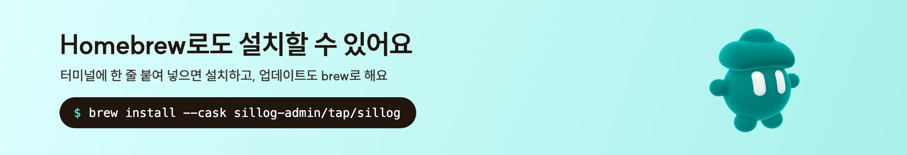

```bash
brew install --cask sillog-admin/tap/sillog
```

- 업데이트: `brew upgrade --cask sillog`
- 삭제: `brew uninstall --cask sillog`
- 기록까지 삭제: `brew uninstall --zap --cask sillog`

dmg로 설치한 SILLOG이 있으면 설치 명령에 `--force`를 붙입니다. `--zap`은 기록과 설정을 휴지통으로 옮기고, 키체인에 저장한 키와 토큰은 남깁니다.

### 처음 실행

1. ChatGPT 계정이나 API 키로 AI를 연결합니다.
2. 손쉬운 사용과 화면 기록 권한을 허용합니다. 화면 기록은 허용한 뒤 앱을 다시 실행해야 적용됩니다.
3. 설정에서 기록할 내용과 쓸 모델을 고릅니다.

기록 일시정지와 지금 정리는 메뉴 막대에서 할 수 있습니다.

## AI 연결

<a href="https://sillog.app"></a>

| 연결 | 쓰는 곳 | 설명 |
| --- | --- | --- |
| ChatGPT 구독 | 정리, 채팅, 판단 | 요금제 사용량 안에서 씁니다 |
| API 서버 | 정리, 채팅, 판단 | OpenAI 호환 서버나 로컬 모델을 씁니다 |
| OpenAI Decisions, Jev | 판단 | 어느 업무인지 고르기만 합니다 |

ChatGPT 구독 연결은 공개 API가 아니어서 규격이 바뀔 수 있습니다.

## 커넥터

Notion, Slack, Google Drive, GitHub 같은 서비스를 연결하면 채팅에서 그 자료도 찾아 읽습니다. 커넥터는 읽기만 하고, 연결 정보는 macOS 키체인에 저장합니다.

직접 빌드해서 커넥터를 설정하는 방법은 [docs/connectors.md](docs/connectors.md)에 있습니다.

## 개인정보와 데이터

<a href="https://sillog.app"></a>

기록은 Mac에 저장하지만, 정리와 채팅에 쓰는 내용은 설정한 모델로 보냅니다. 클라우드 모델을 쓰면 그 내용이 Mac 밖으로 나갑니다. 처리하는 정보, 외부 전송, 보관과 파기, 문의처는 [개인정보 처리방침](https://sillog.app/privacy)에 정리해 두었습니다.

- **기록하는 것**: 앱 이름, 창 제목, 주소, 화면 글자, 스크린샷, 다운로드한 파일, AI 코딩 도구에 보낸 요청, 직접 시작한 녹음.
- **이름과 시간만 남기는 것**: 제외한 앱, 비밀번호 관리자, SILLOG 자신.
- **채팅이 읽는 것**: 대화에서 고른 범위의 기록, 연결한 파일, 보관함 자료, 켜 둔 커넥터.
- **채팅이 하지 않는 것**: 명령 실행, 파일 수정, 메시지 발송, 커넥터에 쓰기.
- **비밀값**: API 키와 토큰은 키체인에 둡니다. 주민등록번호 같은 식별 번호는 모델에 보내기 전에 가립니다.
- **지우기**: 업무나 그래프 노드를 오른쪽 클릭하면 원본 기록까지 함께 지웁니다.

보관 기간 기본값은 아래와 같습니다. 설정 → 일반에서 바꿀 수 있고, 처음 지우기 전에 한 번 묻습니다.

| 화면 글자 | 스크린샷 | 활동 기록 | 화면 카드 | AI 도구 요청, 파일 기록 |
| :---: | :---: | :---: | :---: | :---: |
| 30일 | 7일 | 90일 | 180일 | 365일 |

```text
~/Library/Application Support/Sillog/
├── sillog.sqlite   # 활동, 그래프, 대화, 결과물, 예약
├── captures/       # 스크린샷
├── library/        # 올린 파일, 결과물, 저장한 답변
├── recordings/     # 녹음
├── models/         # 받아쓰기 모델
├── codex-auth.json # 앱 전용 ChatGPT 로그인
└── app.log         # 실행 로그
```

## 자주 묻는 질문

<details>
<summary><b>SILLOG은 무엇을 기록하나요?</b></summary>

앱, 창 제목, 주소, 파일 경로, 화면 글자, 스크린샷, 다운로드한 파일, AI 코딩 도구(Claude Code, Codex CLI)에 입력한 메시지를 기록해요. 2분 넘게 입력이 없으면 자리 비움으로 기록해요. 녹음은 직접 시작했을 때만 하고 Mac 안에서 글로 받아써요.
</details>

<details>
<summary><b>기록은 어디에 저장되나요?</b></summary>

내 Mac에 저장해요. SILLOG은 자체 서버를 두지 않아요.
</details>

<details>
<summary><b>밖으로 나가는 내용은 무엇인가요?</b></summary>

업무를 정리하고 채팅에 답하려고 기록 내용을 내가 연결한 AI 계정으로 보내요. 대표 화면의 스크린샷도 함께 보내요. 채팅에서 찾아본 자료, 허용한 웹 검색과 커넥터 통신도 밖으로 나가요. 보낸 내용은 활동 로그에서 확인하고 기능별로 전송을 끌 수 있어요.
</details>

<details>
<summary><b>어떤 AI 계정이 필요한가요?</b></summary>

ChatGPT 구독과 API(OpenAI 호환) 가운데 하나를 연결해요. ChatGPT 구독으로 채팅하려면 Codex CLI나 Codex 앱이 설치되어 있어야 해요. API로 연결하면 호출 요금이 나와요.
</details>

<details>
<summary><b>기록하고 싶지 않은 앱이 있어요.</b></summary>

기록하지 않을 앱을 추가하면 그 앱은 이름과 시간만 남겨요. 비밀번호 관리자와 키체인은 처음부터 제외되어 있고 비밀번호 입력칸은 기록하지 않아요.
</details>

<details>
<summary><b>스크린샷은 얼마나 보관하나요?</b></summary>

기본 7일이고 1일에서 90일 사이로 바꿀 수 있어요.
</details>

<details>
<summary><b>어떤 컴퓨터에서 쓸 수 있나요?</b></summary>

지금은 macOS 14 이상의 Apple 실리콘 Mac에서 쓸 수 있어요. Windows와 모바일은 아직 준비 중이에요.
</details>

## 아직 안 되는 것

- macOS에서만 쓸 수 있습니다.
- Word, PowerPoint, Excel 결과물은 글과 표만 담은 기본 서식으로 만듭니다.
- 예약 작업은 몇 시간마다 반복하는 방식이고 SILLOG이 켜져 있을 때만 실행합니다. 요일이나 시각은 지정할 수 없습니다.
- 스캔한 PDF는 글자를 인식하지 않고, 이미지는 안에 있는 글자만 읽습니다.
- API 서버로 연결하면 웹 검색은 공식 OpenAI API에서만 됩니다.
- Gmail 커넥터는 없습니다.

## 소스에서 빌드하기

Xcode 26(Swift 6.2)이 필요합니다. Command Line Tools만 있으면 빌드는 되지만 테스트는 돌릴 수 없습니다.

예상 소요 시간: 약 2분

```bash
git clone https://github.com/sillog-admin/SILLOG.git
cd SILLOG
./scripts/make-app.sh
open build/SILLOG.app
```

`make-app.sh`는 릴리스 빌드와 서명을 하고 `~/Applications`에 설치합니다. 개발할 때는 아래 명령을 씁니다.

```bash
swift build
swift test
swift run sillogctl --help
```

`sillogctl`은 기본으로 실제 기록 DB를 엽니다. 실험할 때는 `--db`로 다른 파일을 지정합니다. 더 자세한 내용은 아래 문서에 있습니다.

- [docs/development.md](docs/development.md): 빌드해도 권한을 유지하는 방법, 환경변수, 모델 없이 흐름 확인하기
- [docs/connectors.md](docs/connectors.md): 커넥터별 OAuth 설정
- [CLAUDE.md](CLAUDE.md): 코드 구조와 작성 규칙
- [채팅 시스템 프롬프트](Sources/SillogCore/Chat/Prompts/chat-system-prompt.md), [스킬](Sources/SillogCore/Chat/Skills)

## 기여하기

이슈와 PR 모두 환영합니다. 올리기 전에 확인할 것과 커밋 규칙은 [CONTRIBUTING.md](CONTRIBUTING.md), 보안 문제는 공개 이슈 대신 [보안 정책](SECURITY.md)을 봐 주세요.

## 라이선스

SILLOG은 [GNU Affero General Public License v3.0](LICENSE)으로 배포합니다. 누구나 쓰고 고치고 다시 배포할 수 있습니다. 다만 고친 버전을 배포하거나 웹 서비스처럼 네트워크로 제공한다면, 그 버전의 소스 코드 전체를 같은 라이선스로 공개해야 합니다.

함께 쓰는 라이브러리는 각자의 라이선스를 따릅니다. [GRDB.swift](https://github.com/groue/GRDB.swift), [WhisperKit](https://github.com/argmaxinc/WhisperKit), [SwiftMath](https://github.com/mgriebling/SwiftMath), [LangGraph-Swift](https://github.com/bsorrentino/LangGraph-Swift), [force-graph](https://github.com/vasturiano/force-graph), [FullCalendar](https://github.com/fullcalendar/fullcalendar), [Mermaid](https://github.com/mermaid-js/mermaid)는 MIT이고, SUIT와 Jost 글꼴은 [SIL OFL 1.1](Sources/SillogApp/Resources/Brand/Fonts)입니다. 그 밖의 고지는 [THIRD_PARTY_NOTICES.md](THIRD_PARTY_NOTICES.md)에 있습니다.

---

<div align="center">

    

### 지금 SILLOG을 만나 보세요

<a href="https://github.com/sillog-admin/sillog/releases/latest/download/SILLOG.dmg"></a>&nbsp;
<a href="https://sillog.app"></a>

</div>
